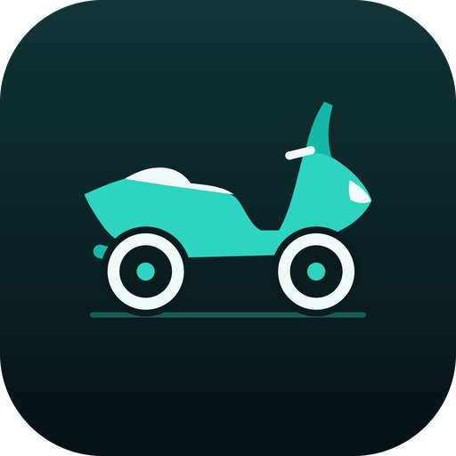

# TurkMax



Yamaha motosikletlerin orijinal TFT navigasyon alanına, Bluetooth üzerinden kendi cockpit
görüntüsünü gönderen açık kaynak Android uygulaması: canlı harita ve navigasyon, dönüş
yönlendirmesi, saat ve telefon pili.

> **English summary.** TurkMax is an open-source Flutter/Android app that streams its own
> cockpit (live navigation map, next turn, clock, phone battery) to the navigation area of a
> Yamaha TFT display over Bluetooth, using an independent implementation of the NaviLite
> protocol. Tested on a single motorcycle (XMAX 250 Tech MAX 2025), stationary. No prebuilt
> binaries: you build it with your own Google Maps Platform key. Documentation is in Turkish.

TurkMax bağımsız bir hobi projesidir. Yamaha Motor, Garmin, Google veya Apple ile hiçbir
bağlantısı yoktur; bu şirketlerin adları yalnızca uyumluluğu tarif etmek için geçer.

## Önce okuyun

- **Sürüş güvenliği.** Sürüş sırasında telefonla etkileşime girmeyin. Uygulama hiçbir garanti
  olmadan, olduğu gibi sunulur; kullanımından doğan sonuçların sorumluluğu kullanıcıdadır.
- **Resmî bir ürün değildir.** Gösterge ile iletişim, belgelenmemiş bir protokolün bağımsız
  uygulamasına dayanır. Bir gösterge yazılımı güncellemesi çalışmasını durdurabilir.
- **Google harita koşulları.** Navigation SDK görüntüsünün Android Auto/CarPlay dışında bir
  araç ekranına aktarılmasına açıkça izin veren bir hüküm bulamadık. Kendi API anahtarınızla
  derlersiniz; bu kullanımın Google koşullarına uygunluğu sizin sorumluluğunuzdadır. Ayrıntı:
  [docs/LICENSE_AND_COMPLIANCE.md](docs/LICENSE_AND_COMPLIANCE.md).
- **Hazır derleme yoktur.** Uygulamayı kendiniz derlersiniz: [docs/SETUP.md](docs/SETUP.md).

## Durum

| Özellik | Durum |
|---|---|
| Göstergeye bağlanma ve el sıkışma | Gerçek motosiklette çalıştı |
| Haritalı cockpit'in TFT'de görünmesi | Gerçek motosiklette çalıştı (motosiklet dururken, ~45 sn) |
| Canlı navigasyon, adres arama | Telefonda çalışıyor |
| Uygulama arka plandayken harita | Telefonda sahte göstergeyle çalışıyor; **motosiklette denenmedi** |
| Sürüş sırasında, uzun süreli kullanım | **Denenmedi** |
| Müzik bilgisi, bildirim özeti | Yok (yer tutucu demo verisi) |
| GPS hızı, tur kaydı | Planlandı |
| iOS | Yok |

Denenen tek donanım: Yamaha XMAX 250 Tech MAX 2025 ve bir Android 11 telefon. Ölçümler ve
bulgular:
[docs/FIELD_TEST_RESULTS.md](docs/FIELD_TEST_RESULTS.md).

Başka bir modelde denerseniz sonucu (çalışsın ya da çalışmasın) bağlantı günlüğüyle birlikte
bildirmeniz projeye en büyük katkıdır.

## Nasıl çalışır

```
Navigation SDK ─► sanal ekranda harita ─┐
Flutter cockpit durumu ─────────────────┼─► 480×234 kare ─► JPEG ─► NaviLite (RFCOMM) ─► TFT
```

- Harita, telefon ekranından bağımsız olarak görünmez bir sanal ekrana çizilir; bu sayede
  uygulama arka plandayken de güncellenir.
- Kareler tek tek gönderilir ve gösterge her birini onaylar; hız bağlantının taşıyabildiği
  veriyle sınırlıdır (ilk testte haritada 6–10 FPS).
- Protokol kodu bağımsız olarak yazılmıştır; ayrıntılar
  [docs/NAVILITE_PROTOCOL.md](docs/NAVILITE_PROTOCOL.md).

Mimari: [docs/ARCHITECTURE.md](docs/ARCHITECTURE.md).

## Belgeler

- [docs/SETUP.md](docs/SETUP.md) — derleme ve kurulum
- [docs/GOOGLE_API_SETUP.md](docs/GOOGLE_API_SETUP.md) — API anahtarı ve sorun giderme
- [docs/FIELD_TEST.md](docs/FIELD_TEST.md) — motosiklette test adımları
- [docs/FIELD_TEST_RESULTS.md](docs/FIELD_TEST_RESULTS.md) — gerçek gösterge testi sonuçları
- [docs/NAVILITE_PROTOCOL.md](docs/NAVILITE_PROTOCOL.md) — protokol
- [docs/ARCHITECTURE.md](docs/ARCHITECTURE.md) — mimari
- [docs/ROADMAP.md](docs/ROADMAP.md) — yol haritası
- [docs/KNOWN_LIMITATIONS.md](docs/KNOWN_LIMITATIONS.md) — bilinen sınırlamalar
- [docs/LICENSE_AND_COMPLIANCE.md](docs/LICENSE_AND_COMPLIANCE.md) — lisans ve uyumluluk notları
- [CONTRIBUTING.md](CONTRIBUTING.md) — katkı kuralları

## Teşekkür

NaviLite protokolüne ilişkin bilgiler, [Pillion](https://github.com/alexandrevega/pillion)
projesinin kamuya açık belge ve kaynaklarının incelenmesiyle derlendi. TurkMax, Pillion'dan
kod içermez; protokol kodu bu olgulara dayanarak bağımsız yazılmıştır.

## Lisans

Telif hakkı © 2026 TurkMax katkıcıları.

TurkMax özgür yazılımdır: GNU Genel Kamu Lisansı'nın 3. sürümü (GPL-3.0) koşulları altında
yeniden dağıtabilir ve değiştirebilirsiniz. Yazılım, yararlı olması umuduyla ancak HİÇBİR
GARANTİ VERİLMEDEN dağıtılır. Lisansın tam metni: [LICENSE](LICENSE).

Uygulama; Google Navigation SDK ve Google Play Hizmetleri gibi kendi koşullarına tabi üçüncü
taraf bileşenlere bağlanır. Bu bileşenler TurkMax'in lisansı kapsamında değildir.
